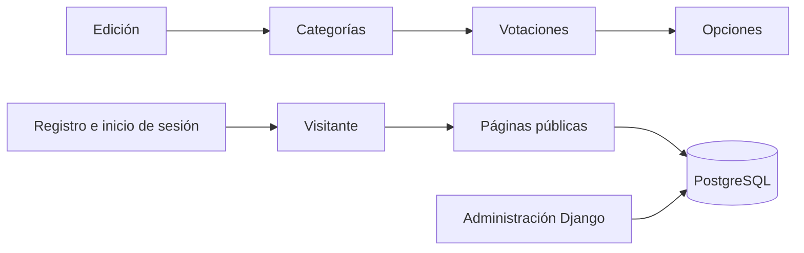

<div align="center">


# Sistema de votaciones
### Festival de la Leyenda Vallenata · Edición 2027

Aplicación web académica para explorar categorías y votaciones del festival,<br>
con catálogo conectado a PostgreSQL y cuentas de usuario gestionadas con Django.

<p>
  
  
  
  
</p>

[Explorar el proyecto](#-el-proyecto) ·
[Instalar](#-instalación-en-windows) ·
[Abrir páginas](#-rutas-disponibles) ·
[Consultar documentación](#-documentación)

</div>

---

## ✨ El proyecto

Este proyecto convierte el prototipo inicial en una aplicación Django ejecutable. Permite consultar información organizada por edición, categoría, votación y opción; registrarse e iniciar sesión; y administrar el catálogo desde Django Admin.

> **Estado de esta entrega:** el sitio consulta y presenta información, pero **no registra votos ni calcula resultados oficiales**. Los datos generados por el comando de demostración son de prueba.

### En un vistazo

| | |
|:--|:--|
| **Aplicación** | Sistema web para explorar votaciones del Festival de la Leyenda Vallenata |
| **Tecnologías** | Python 3.12 · Django 4.2 LTS · PostgreSQL |
| **Idioma y zona horaria** | Español (Colombia) · `America/Bogota` |
| **Tipo de proyecto** | Proyecto académico — Entrega 2 |
| **Plataforma recomendada** | Windows 10 o superior |

### Recorrido de la información



## 🧭 Navegación

- [El proyecto](#-el-proyecto)
- [Funciones incluidas y pendientes](#-funciones-incluidas-y-pendientes)
- [Instalación en Windows](#-instalación-en-windows)
- [Inicio rápido](#-inicio-rápido)
- [Rutas disponibles](#-rutas-disponibles)
- [Estructura del código](#-estructura-del-código)
- [Pruebas](#-pruebas)
- [Documentación](#-documentación)
- [Seguridad y configuración](#-seguridad-y-configuración)

## ✅ Funciones incluidas y pendientes

<details open>
<summary><strong>Incluido en esta entrega</strong></summary>

- Páginas públicas de inicio, categorías, votaciones, detalle y resultados.
- Lectura de datos desde PostgreSQL mediante el ORM de Django.
- Relaciones del catálogo: **Edición → Categoría → Votación → Opción**.
- Registro, inicio y cierre de sesión, y página de perfil.
- Administración del catálogo desde Django Admin.
- Comando para cargar datos de demostración.

</details>

<details>
<summary><strong>Aún no implementado</strong></summary>

- Registro o almacenamiento de votos.
- Prevención de votos duplicados o reglas de elegibilidad.
- Resultados oficiales o auditoría electoral.
- Despliegue en un servidor público.

</details>

## 🛠️ Instalación en Windows

### Requisitos

- [Python 3.12](https://www.python.org/downloads/) y el lanzador `py`.
- [PostgreSQL 12 o superior](https://www.postgresql.org/download/). El desarrollo del proyecto se documentó con PostgreSQL 17.
- Git, para clonar el repositorio.

### 1. Obtener el proyecto y preparar el entorno

Abre PowerShell y ejecuta:

```powershell
git clone https://github.com/JJMR07/Festival-Votaciones.git
cd Festival-Votaciones

py -3.12 -m venv venv
.\venv\Scripts\Activate.ps1
python -m pip install --upgrade pip
pip install -r requirements.txt
```

Si PowerShell bloquea la activación del entorno virtual, consulta la [documentación de políticas de ejecución de PowerShell](https://learn.microsoft.com/powershell/module/microsoft.powershell.security/set-executionpolicy). Como alternativa, puedes ejecutar los comandos usando `venv\Scripts\python.exe` sin activar el entorno.

### 2. Crear la base de datos

Inicia PostgreSQL desde sus servicios o desde la consola y crea la base:

```powershell
createdb -U postgres votaciones_festival
```

Si `createdb` no está en el `PATH`, ejecuta `createdb.exe` desde la carpeta `bin` de PostgreSQL. Si la base ya existe, no es necesario crearla de nuevo.

### 3. Configurar las variables de entorno

```powershell
Copy-Item .env.example .env
```

Abre `.env` y ajusta los datos de conexión según tu instalación:

```dotenv
SECRET_KEY=reemplazar-por-una-clave-secreta-larga
DEBUG=True
ALLOWED_HOSTS=127.0.0.1,localhost

DB_NAME=votaciones_festival
DB_USER=postgres
DB_PASSWORD=tu_contraseña_local
DB_HOST=127.0.0.1
DB_PORT=5432
```

### 4. Preparar las tablas y los datos

```powershell
python manage.py migrate
python manage.py createsuperuser
python manage.py cargar_datos_prueba
```

El último comando carga contenido de demostración para explorar el catálogo; puede ejecutarse más de una vez.

### 5. Ejecutar el servidor

```powershell
python manage.py runserver
```

Abre [http://127.0.0.1:8000/](http://127.0.0.1:8000/) en tu navegador. Para detener el servidor, pulsa `Ctrl+C` en PowerShell.

## ⚡ Inicio rápido

En Windows, después de completar la instalación, también puedes ejecutar `iniciar_proyecto.bat` con doble clic. El script intenta iniciar PostgreSQL desde la ubicación de Scoop, activa la carpeta virtual `venv` e inicia Django.

> **Nota:** el archivo `.bat` está preparado para una instalación local con PostgreSQL administrado por Scoop. Si usas otra instalación, inicia PostgreSQL por separado y ejecuta `python manage.py runserver` desde el entorno virtual.

## 🌐 Rutas disponibles

| Página | URL |
|:--|:--|
| Inicio | [http://127.0.0.1:8000/](http://127.0.0.1:8000/) |
| Categorías | [http://127.0.0.1:8000/categorias/](http://127.0.0.1:8000/categorias/) |
| Votaciones | [http://127.0.0.1:8000/votaciones/](http://127.0.0.1:8000/votaciones/) |
| Detalle de votación | `/votaciones/<id>/` |
| Resultados de demostración | [http://127.0.0.1:8000/resultados/](http://127.0.0.1:8000/resultados/) |
| Registro | [http://127.0.0.1:8000/cuentas/registro/](http://127.0.0.1:8000/cuentas/registro/) |
| Iniciar sesión | [http://127.0.0.1:8000/cuentas/login/](http://127.0.0.1:8000/cuentas/login/) |
| Perfil | [http://127.0.0.1:8000/cuentas/perfil/](http://127.0.0.1:8000/cuentas/perfil/) |
| Administración | [http://127.0.0.1:8000/admin/](http://127.0.0.1:8000/admin/) |

## 🧩 Estructura del código

```text
catalogo/      Modelos, vistas, rutas y administración del catálogo
cuentas/       Registro, autenticación, perfil y cierre de sesión
config/        Configuración del proyecto y rutas principales
templates/     Plantillas HTML de las páginas
static/        CSS, JavaScript e imágenes
prototipo_entrega1/  Prototipo HTML de referencia de la entrega anterior
docs/          Documentación técnica y material de entrega
manage.py      Herramienta de administración de Django
requirements.txt    Dependencias Python del proyecto
```

El proyecto sigue el patrón **MVT** de Django:

1. **Modelo:** define los datos y sus relaciones en `catalogo/models.py`.
2. **Vista:** consulta datos o gestiona autenticación en `catalogo/views.py` y `cuentas/views.py`.
3. **Plantilla:** presenta las páginas HTML desde `templates/`.

## 🧪 Pruebas

Con el entorno virtual activo, PostgreSQL iniciado y `.env` configurado:

```powershell
python manage.py test
```

## 📚 Documentación

- [Documento técnico](docs/DOCUMENTO_TECNICO.md): arquitectura, configuración, modelos, autenticación y solución de problemas.
- [Documento de Entrega 2](docs/ENTREGA_2.md): alcance académico y descripción de la implementación.

## 🔐 Seguridad y configuración

- No subas `.env`, contraseñas, claves secretas ni datos personales al repositorio.
- Usa `DEBUG=True` únicamente en desarrollo local.
- Antes de publicar el sistema, configura una clave secreta propia, `DEBUG=False`, `ALLOWED_HOSTS`, HTTPS y una base de datos segura.
- Los datos de `cargar_datos_prueba` son ejemplos y no representan candidatos ni resultados oficiales.

---

<div align="center">

Hecho como proyecto académico de Desarrollo Web<br>
**Fundación Universitaria del Área Andina · 2026**

</div>
